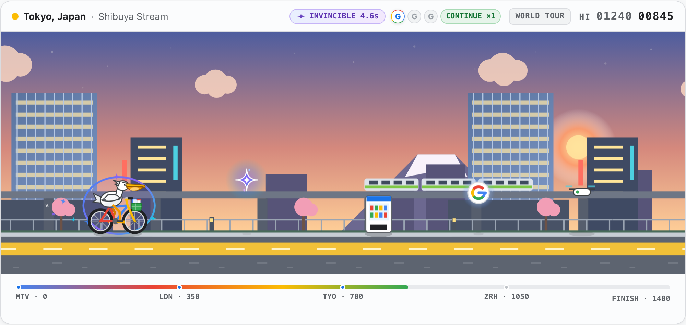

# Pelican on a Bike — Google Campus World Tour

**Play live (GitHub Pages):** https://mlaslie.github.io/pelican-on-a-bike/

A zero-build, Chrome Dino–inspired endless and World Tour runner featuring an animated vector pelican riding a 4-color Google GBike through realistic multi-layer parallax scenes of global Google campuses.

> Built in **Google Antigravity** using **Gemini 4 Neon**.

## Screenshots

### Mountain View — Bay View & Googleplex


### Tokyo — Shibuya Stream & Gemini Invincibility


## Campuses Included
1. **Mountain View, CA** (`0–350 pts`) — Bay View dragonscale solar canopy, Googleplex, Stan the T-Rex skeleton, and 4-color umbrellas
2. **London, UK** (`350–700 pts`) — King's Cross KGX1 Landscraper with rooftop greenery, St Pancras clocktower, and red double-decker bus
3. **Tokyo, Japan** (`700–1050 pts`) — Shibuya Stream tower, elevated viaduct with Yamanote Line train, Mt. Fuji dusk silhouette, and sakura promenade
4. **Zurich, Switzerland** (`1050–1400 pts`) — Hürlimann Areal brick brewery & chimney, snow-capped Swiss Alps alpenglow, and VBZ tram

Use the **Campus Jump Picker** below the stage to jump straight into any campus, or complete the **1,400-point World Tour** to unlock **Endless Mode**.

## Power-Ups
- **Gemini Sparkle**: Grants **6.0 seconds of invincibility** with a starlight aura, smashing collided obstacles out of your path.
- **3× Google `G` Logos**: Collect three floating `G` medallions to earn a **Free Continue**—when you hit an obstacle, resume right from that spot with your score and campus intact plus a brief safety shield.

## Controls
- `Space` / `↑` / `W`: Jump (hold slightly longer for higher arc) & Start / Restart / Free Continue
- `↓` / `S`: Duck & airborne fast-fall
- `B`: Ring bike bell
- `P` / `Esc`: Pause / Resume
- `M`: Mute / Unmute synthesized Web Audio SFX
- Touch buttons (`DUCK` / `JUMP`) & tap-to-jump supported on touch devices

## Run Locally
Open `index.html` directly in a browser, or serve the folder over HTTP:

```bash
python3 -m http.server 8765
```

Then visit `http://localhost:8765/`.

## Install as a Chrome Extension (Manifest V3)
This repo is also a self-contained **Manifest V3 Chrome extension** (zero extra permissions, runs 100% offline):

1. Clone this repository or click **Code → Download ZIP** on GitHub and unzip it.
2. Open `chrome://extensions` in Google Chrome and enable **Developer mode** (top-right toggle).
3. Click **Load unpacked** and select the `pelican-on-a-bike` folder.
4. Pin **Pelican on a Bike** in your Chrome toolbar and click the pelican icon anytime to open (or focus) the game tab.
