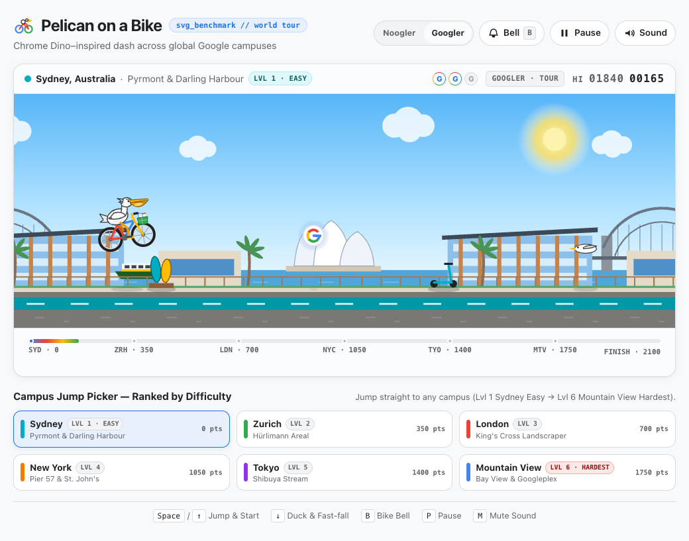
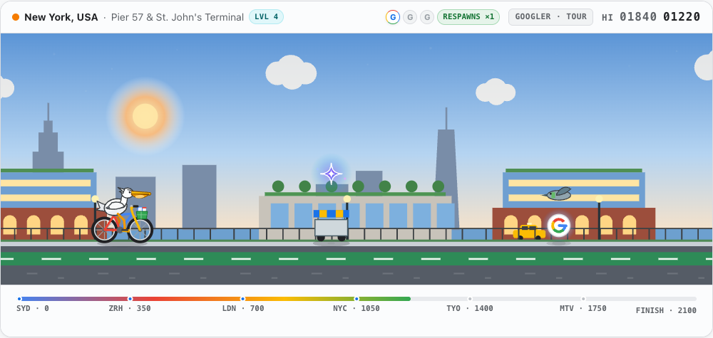
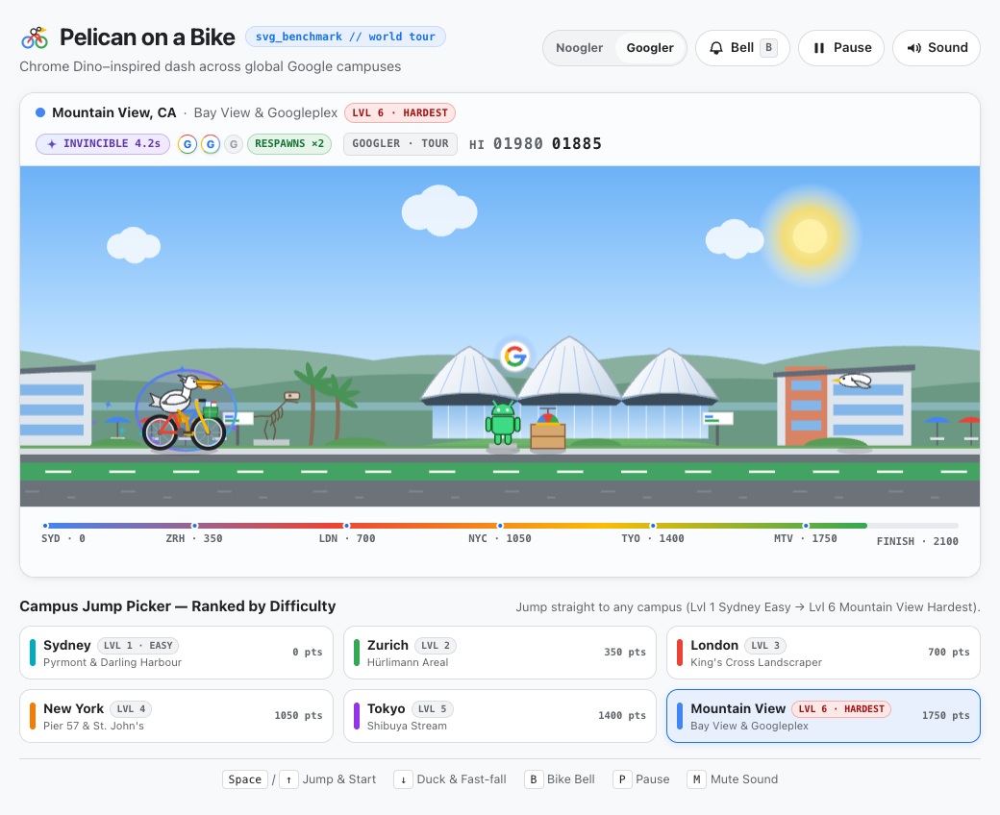
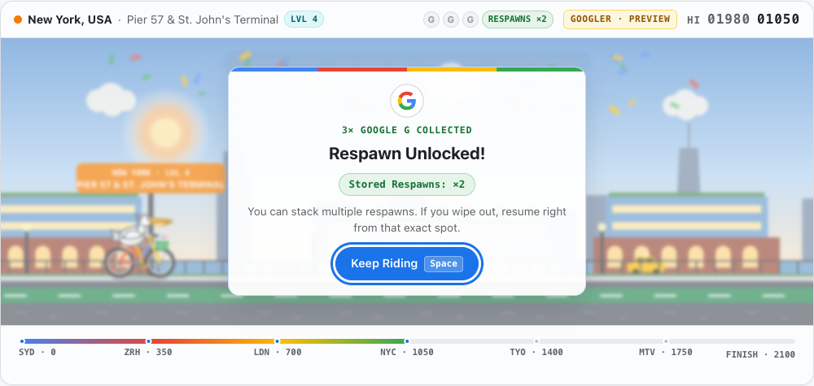

# Pelican on a Bike — Google Campus World Tour

**Play live (GitHub Pages):** https://mlaslie.github.io/pelican-on-a-bike/

A zero-build, Chrome Dino–inspired endless and World Tour runner featuring an animated vector pelican riding a 4-color Google GBike through realistic multi-layer parallax scenes of global Google campuses.

> Built in **Google Antigravity** using **Gemini 4 Neon**.

## Screenshots

### Sydney — Pyrmont & Darling Harbour (`LVL 1 · EASY`)


### New York — Pier 57 & St. John's Terminal (`LVL 4`)


### Mountain View — Bay View & Googleplex (`LVL 6 · HARDEST`)


### Respawn Unlocked Splash (`3× Google G`)


## Campuses Included (Ranked Easiest → Hardest)
1. **Sydney, Australia** (`0–350 pts` · `LVL 1 · EASY`) — Pyrmont waterfront, Sydney Opera House, Harbour Bridge, and Darling Harbour ferry
2. **Zurich, Switzerland** (`350–700 pts` · `LVL 2`) — Hürlimann Areal brick brewery & chimney, snow-capped Swiss Alps alpenglow, and VBZ tram
3. **London, UK** (`700–1050 pts` · `LVL 3`) — King's Cross KGX1 Landscraper with rooftop greenery, St Pancras clocktower, and double-decker bus
4. **New York, USA** (`1050–1400 pts` · `LVL 4`) — Pier 57 rooftop park, St. John's Terminal, Manhattan skyline, and NYC yellow cab
5. **Tokyo, Japan** (`1400–1750 pts` · `LVL 5`) — Shibuya Stream tower, elevated viaduct with Yamanote Line train, Mt. Fuji dusk silhouette, and sakura promenade
6. **Mountain View, CA** (`1750–2100 pts` · `LVL 6 · HARDEST`) — Bay View dragonscale solar canopy, Googleplex, Stan the T-Rex skeleton, and 4-color umbrellas

Use the **Campus Jump Picker** below the stage to jump straight into any campus, or complete the **2,100-point World Tour** to unlock **Endless Mode**.

## Speed Modes & Difficulty
- **Googler (Default):** Chrome Dino–style continuous acceleration from `370 px/s` in Sydney up to `720 px/s` in Mountain View and `880 px/s` in Endless Mode, with separate high-score tracking.
- **Noogler:** Steady comfortable cruise speed (`380 px/s`) throughout the tour with its own high-score board.
- **Escalating Obstacle Patterns:** Double ground obstacle clusters (`Lvl 2+`), **Jump → Fast-Fall → Duck** combos (`Lvl 3+`), faster aerials (`1.15× → 1.34×`), and swooping birds/drones (`Lvl 4+`).

## Power-Ups
- **Gemini Sparkle:** Grants **6.0 seconds of invincibility** with a starlight aura and live countdown, smashing collided obstacles out of your path.
- **3× Google `G` Logos (Stackable Respawns):** Collecting 3 medallions pauses gameplay for a **Respawn Unlocked!** splash screen and banks a respawn (`RESPAWNS ×N`, stackable without cap). On a crash, resume right from that exact spot with your score and campus intact.
- **Progressive Risk–Reward Placement:** In harder campuses, Gemini sparkles and `G` logos increasingly spawn in bold jump arcs directly over obstacles or low-duck lanes beneath aerials.

## Controls
- `Space` / `↑` / `W`: Jump (hold slightly longer for higher arc) & Start / Restart / Free Continue
- `↓` / `S`: Duck & airborne fast-fall
- `B`: Ring bike bell
- `P` / `Esc`: Pause / Resume
- `M`: Mute / Unmute synthesized Web Audio SFX
- Touch buttons (`DUCK` / `JUMP`) & tap-to-jump supported on touch devices

## Run Locally
Open `index.html` directly in a browser, or serve the folder over HTTP:

```bash
python3 -m http.server 8765
```

Then visit `http://localhost:8765/`.

## Install as a Chrome Extension (Manifest V3)
This repo is also a self-contained **Manifest V3 Chrome extension** (zero extra permissions, runs 100% offline):

1. Clone this repository or click **Code → Download ZIP** on GitHub and unzip it.
2. Open `chrome://extensions` in Google Chrome and enable **Developer mode** (top-right toggle).
3. Click **Load unpacked** and select the `pelican-on-a-bike` folder.
4. Pin **Pelican on a Bike** in your Chrome toolbar and click the pelican icon anytime to open (or focus) the game tab.
